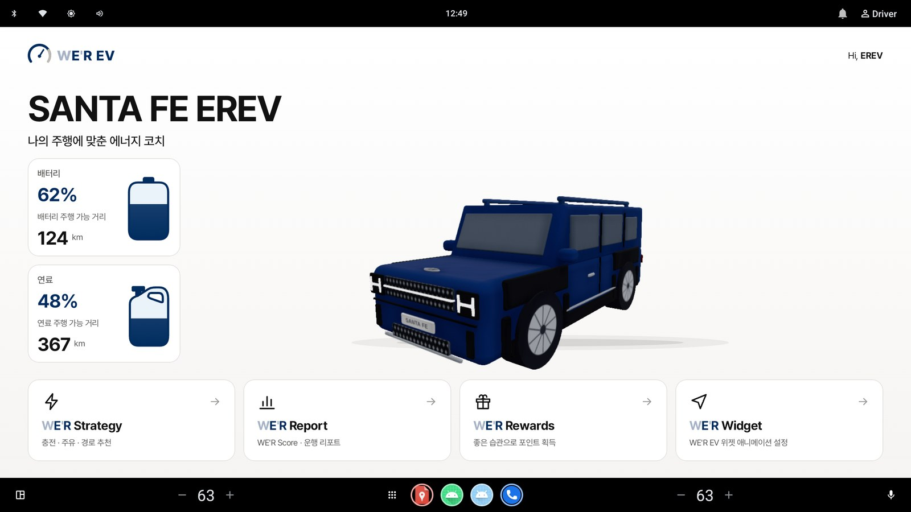
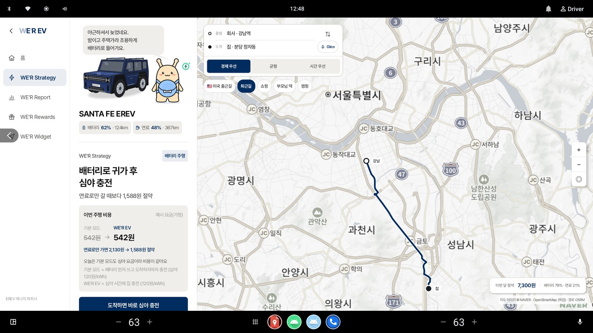
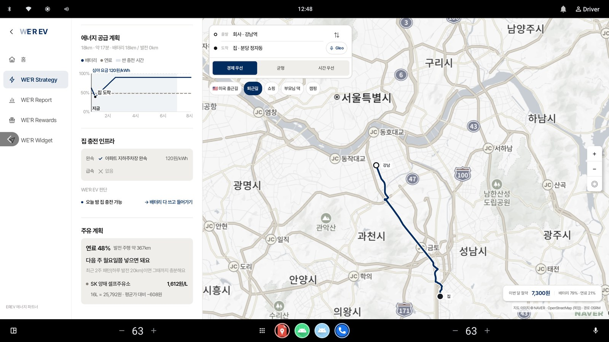
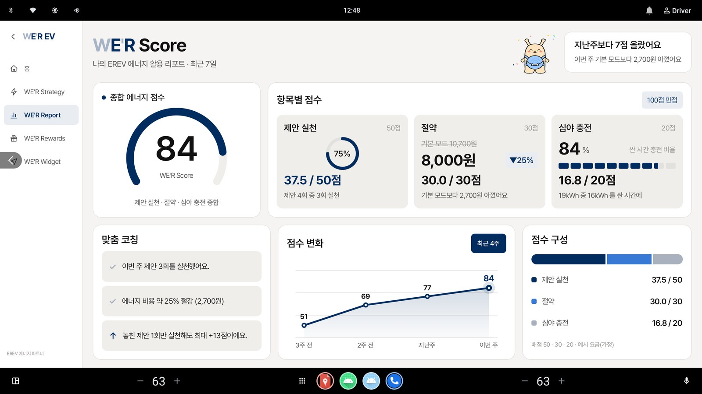
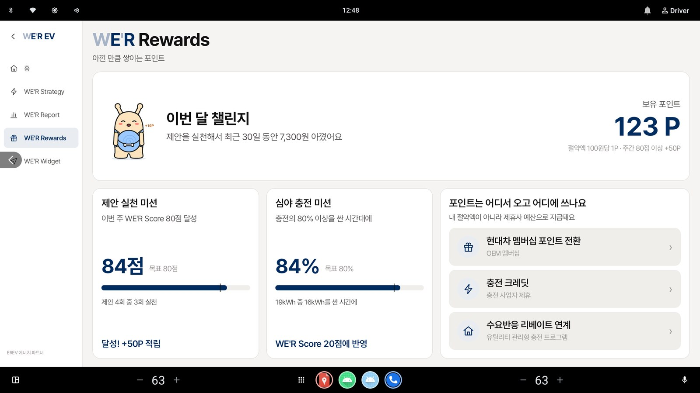
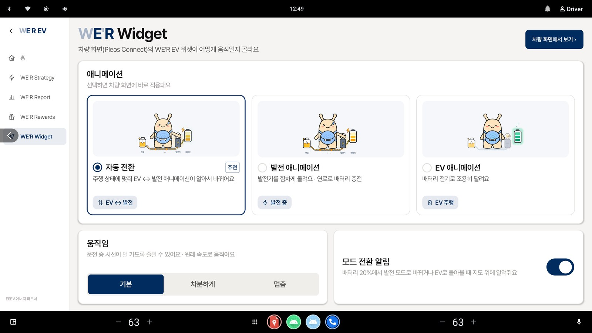
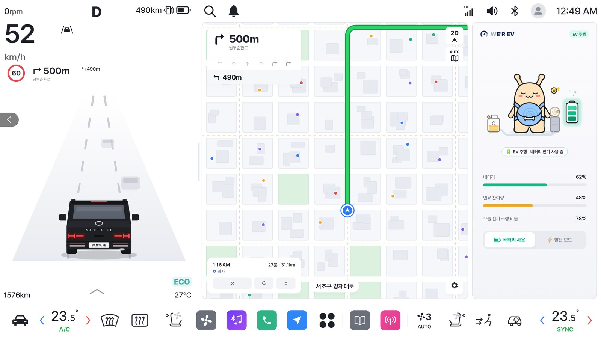
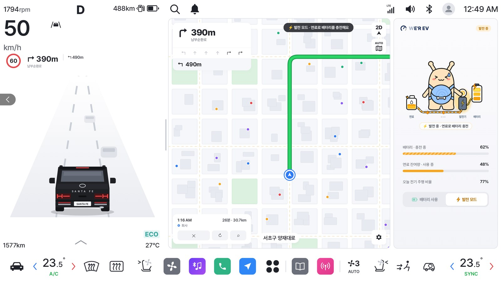
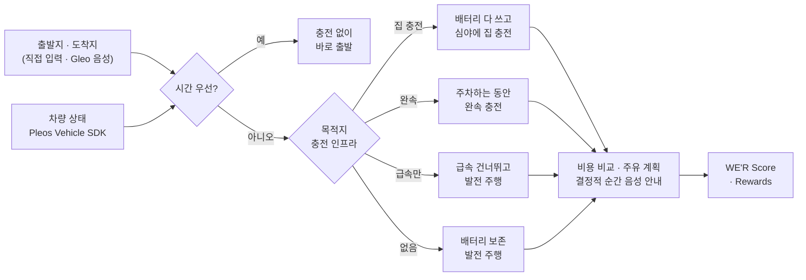

<div align="center">

# ⚡ WE'R EV

### 나의 주행에 맞춘 EREV 에너지 코치

**SANTA FE EREV** 운전자를 위해, 언제 · 어디서 · 무엇으로(전기 / 연료) 채울지 알려주는 Pleos 차량 앱

<br/>


<br/>



</div>

<br/>

## 📌 목차

- [한눈에 보기](#-한눈에-보기)
- [시연 영상](#-시연-영상)
- [화면 구성](#-화면-구성)
- [어떻게 판단하나요](#-어떻게-판단하나요)
- [프로젝트 구조](#-프로젝트-구조)
- [실행 방법](#-실행-방법)
- [시연 조작법](#-시연-조작법)
- [참고 사항](#-참고-사항)

<br/>

## 💡 한눈에 보기

EREV(주행거리 연장형 전기차)는 **배터리로 달리다가 부족하면 엔진이 발전**해서 달립니다.
차는 스스로 "배터리 먼저, 그다음 발전"만 할 뿐, **시간대별 전기요금 · 주유소 가격 · 목적지 충전 인프라 · 주차 시간**은 모릅니다.

WE'R EV는 그 빈틈을 채웁니다.

| | 차 기본 모드 | **WE'R EV** |
|---|---|---|
| 충전 시각 | 도착하자마자 (피크 요금일 수도) | **가장 싼 시간대**에 집 충전 예약 |
| 목적지 | 고려 안 함 | 완속 있으면 **주차하는 동안 충전** |
| 급속 충전 | 보이면 충전 | 비싸고 오래 걸리면 **건너뛰고 발전 주행** |
| 주유 | 아무 데서나 | 동선 위 **싼 주유소 · 넣을 시점**까지 |
| 결과 | — | 절약액을 **WE'R Score · 포인트**로 보상 |

<br/>

## 🎬 시연 영상

> **[▶ 시연 영상 보기 (docs/demo/WERE_EV_demo.mp4)](docs/demo/WERE_EV_demo.mp4)** · 1분 20초 · 소리 있음

1. 🏠 **홈** — 배터리 · 연료 잔량과 주행 가능 거리
2. ⚡ **WE'R Strategy** — 「쇼핑」 스타필드 하남 → 주차 중 완속 충전 전략
3. 🎙️ **Gleo 음성 명령** "스타필드에서 집으로 가자" → Gleo가 소리로 대답 → 전략이 **"배터리로 귀가 후 심야 충전"** 으로 바뀜
4. 📈 에너지 공급 계획 · 집 충전 인프라 · 주유 계획
5. 🚗 주행 시작 → 제안 승인 → 🔊 **결정적 순간 음성 안내** → 주행 종료
6. 📊 **WE'R Report** 86점 (지난주보다 9점 ↑) → 🎁 **WE'R Rewards** 123P
7. 🐌 **WE'R Widget** → Pleos Connect 차량 화면 → **발전 모드 전환**

<br/>

## 🖥 화면 구성

<table>
  <tr>
    <td width="50%" align="center"><br/><b>⚡ WE'R Strategy</b><br/><sub>경로별 충전 · 주유 전략과 이번 주행 비용</sub></td>
    <td width="50%" align="center"><br/><b>📈 에너지 공급 계획</b><br/><sub>싼 충전 시간대 · 목적지 충전 인프라 · 주유 계획</sub></td>
  </tr>
  <tr>
    <td align="center"><br/><b>📊 WE'R Report</b><br/><sub>제안 실천 · 절약 · 심야 충전으로 매기는 WE'R Score</sub></td>
    <td align="center"><br/><b>🎁 WE'R Rewards</b><br/><sub>아낀 만큼 쌓이는 포인트와 주간 미션</sub></td>
  </tr>
  <tr>
    <td align="center"><br/><b>🐌 WE'R Widget</b><br/><sub>차량 화면 위젯 애니메이션 · 움직임 · 알림 설정</sub></td>
    <td align="center"><br/><b>🚗 Pleos Connect · EV 주행</b><br/><sub>차량 화면 시뮬레이터 (계기판 · 내비 · 위젯)</sub></td>
  </tr>
  <tr>
    <td colspan="2" align="center"><br/><b>🔥 Pleos Connect · 발전 모드</b><br/><sub>위젯 하단 「발전 모드」를 누르면 연료 → 발전기 → 배터리 흐름으로 전환</sub></td>
  </tr>
</table>

<br/>

## 🧠 어떻게 판단하나요



- **주행 가능 거리** — 배터리 100% = 200km, 연료 100% = 765km (홈 · 전략 · 차량 화면이 같은 계산 사용)
- **비용 비교** — 같은 거리를 *차 기본 모드*로 갔을 때 / *연료로만* 갔을 때와 비교
- **결정적 순간 음성** — 주행당 1번만, 위젯 한 줄과 같은 문장을 TTS로 안내 (운전 중 시선 분산 최소화)
- **WE'R Score (100점)** — 제안 실천 50 · 절약 30 · 심야 충전 20

<br/>

## 📁 프로젝트 구조

```
WE_R_EV/
├── rrr_pleos_3/rrr_pleos_3/          # 🚗 차량 앱 (Gradle 프로젝트)
│   ├── app/                          #    WE'R EV 차량 앱  ─ com.example.rrr
│   │   └── src/main/java/com/example/rrr/
│   │       ├── MainActivity.kt       #      홈 · 전략 · 사이드바 · Gleo 대화창
│   │       ├── Planner.kt            #      충전/주유 전략 · 비용 계산
│   │       ├── ScoreViews.kt         #      WE'R Report · Rewards
│   │       ├── WidgetSettingsPage.kt #      WE'R Widget 설정
│   │       ├── RrrWidgetAnimation.kt #      위젯 캐릭터 애니메이션 (Compose Canvas)
│   │       ├── GleoBridge.kt         #      Gleo 음성 명령 → 출발/도착 설정
│   │       └── pleos/                #      Pleos SDK 게이트웨이 (Vehicle · Navi · TTS)
│   ├── pleos_connect/                #    Pleos Connect 차량 화면 시뮬레이터 ─ com.example.pleosconnect
│   └── docs/                         #    워크플로우 · 검증 문서
├── rrr_phone/                        # 📱 폰 앱 ─ com.example.rrrphone
│                                     #    구글 캘린더 일정 → 1차 충전 전략 → Pleos 로 전송
└── docs/
    ├── images/                       #    README 스크린샷
    └── demo/WERE_EV_demo.mp4         #    시연 영상
```

<br/>

## 🚀 실행 방법

### 준비물
- **Android Studio** (JDK는 Android Studio 내장 JBR 사용)
- **Android Automotive 에뮬레이터** — 2560×1440, API 34 이상
- Pleos Playground SDK 는 `settings.gradle.kts` 의 Pleos Nexus 저장소에서 자동으로 받아요

### 빌드 & 설치

```bash
cd rrr_pleos_3/rrr_pleos_3

# 차량 앱
./gradlew :app:installDebug

# Pleos Connect 차량 화면 시뮬레이터
./gradlew :pleos_connect:installDebug
```

> `local.properties` 의 `sdk.dir` 이 내 PC의 Android SDK 경로와 다르면 수정하거나 `ANDROID_HOME` 환경 변수를 지정하세요.

<br/>

## 🎮 시연 조작법

화면에는 보이지 않는 **숨은 조작**으로 주행 흐름을 재현할 수 있어요. (시연 영상 촬영용)

| 동작 | 위치 | 결과 |
|---|---|---|
| **길게 누르기** | 전략 페이지 상단 차 · 캐릭터 그림 | 주행 시작 / 주행 종료 (점수 반영) |
| **두 번 탭** | 〃 | 결정적 순간 음성 안내 |
| **길게 누르기** | 「SANTA FE EREV」 글자 | 시연 도구 패널 열기 / 닫기 |
| **탭** | 차량 화면 위젯 하단 「배터리 사용 / 발전 모드」 | EV ↔ 발전 모드 전환 |

**Gleo 음성 명령 보내기** (실제 Gleo 가 앱에 전달하는 것과 같은 Intent)

```bash
adb shell am start -a com.example.rrr.action.SET_TRIP \
  -n com.example.rrr/.MainActivity --es utterance '스타필드에서 집으로 가자'
```

<br/>

## 📝 참고 사항

- **예시 데이터** — 배터리 62% · 연료 48%, 최근 4주 주행 기록, 전기요금 · 유가는 데모용 예시 값이에요.
- **음성(TTS)** — Pleos TTS 를 먼저 사용하고, Pleos 서비스가 없는 기기(일반 에뮬레이터)에서는 안드로이드 기본 TTS 로 대신 읽어요.
- **Pleos SDK 연결** — Vehicle · NaviHelper · TTS 연결에 실패하면 각 기능이 데모 값으로 동작해요. 실시간 차량 값을 받으면 「PLEOS 실시간」 배지가 표시돼요.
- **차량 화면 시뮬레이터** — `WereEV_PleosConnect.html` 주행 목업(1920×1080)의 레이아웃 · 아이콘을 Compose 로 옮겼어요.

<br/>

<div align="center">

**WE'R EV** · EREV 에너지 파트너

</div>
