<div align="center">

#  WE'R EV

### 나의 주행에 맞춘 EREV 에너지 코치

**SANTA FE EREV** 운전자를 위해, 언제 · 어디서 · 무엇으로(전기 / 연료) 채울지 알려주는 **Pleos 차량 앱**

<br/>

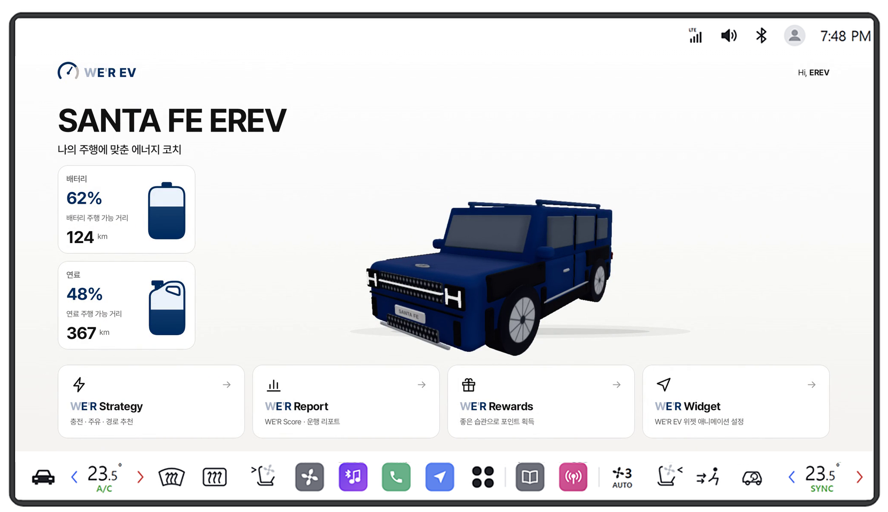

</div>

<br/>

## 📦 실행 정보

| 항목 | 내용 |
|---|---|
| **앱 이름** | WE'R EV — SANTA FE EREV 운전자를 위한 충전 · 주유 전략 코치 (Pleos 차량 앱 + 폰 앱) |
| **APK (Release)** | **[GitHub Release v1.0.0](https://github.com/onlyho12-sketch/WE_R_EV/releases/tag/v1.0.0)** — `WE_R_EV_Pleos.apk` (차량 앱) · `WE_R_EV_Phone.apk` (폰 앱) |
| **에뮬레이터** | **Pleos Connect v2.1.0** |
| **화면 규격** | 2560 × 1440 (가로), Android Automotive API 34 이상 |
| **폰 앱 환경** | Android 폰 / 에뮬레이터 API 29 이상 |
| **필요한 설정** | 별도 키 · 계정 설정 없음 — APK 설치 후 바로 실행 (데모 데이터 내장) |
| **실행 방법** | [🚀 실행 방법](#-실행-방법) · [🎮 시연 조작법](#-시연-조작법) |
| **영상** | [🎬 홍보 영상](docs/demo/WE_R_EV_홍보영상.mp4) (1분 21초) · [▶ 시연 영상](docs/demo/WE_R_EV_시연영상.mp4) (1분 35초) |

**APK로 바로 실행하기**

```bash
adb install WE_R_EV_Pleos.apk   # Pleos Connect v2.1.0 에뮬레이터에 차량 앱 설치
adb install WE_R_EV_Phone.apk   # 폰 / 폰 에뮬레이터에 폰 앱 설치
```

<br/>

## 📌 목차

- [한눈에 보기](#-한눈에-보기)
- [영상](#-영상)
- [화면 구성](#-화면-구성)
- [판단 방식](#-판단-방식)
- [📱 함께 쓰는 폰 앱](#-함께-쓰는-폰-앱)
- [기술 스택](#-기술-스택)
- [프로젝트 구조](#-프로젝트-구조)
- [실행 방법](#-실행-방법)
- [시연 조작법](#-시연-조작법)
- [참고 사항](#-참고-사항)

<br/>

## 💡 한눈에 보기

EREV(주행거리 연장형 전기차)는 **배터리로 달리다가 부족하면 엔진이 발전**해서 달립니다.
차는 스스로 "배터리 먼저, 그다음 발전"만 할 뿐, **시간대별 전기요금 · 주유소 가격 · 목적지 충전 인프라 · 주차 시간**은 모릅니다.

WE'R EV는 그 빈틈을 채웁니다.

| | 차 기본 모드 | **WE'R EV** |
|---|---|---|
| 충전 시각 | 도착하자마자 (피크 요금일 수도) | **가장 싼 시간대**에 집 충전 예약 |
| 목적지 | 고려 안 함 | 완속 있으면 **주차하는 동안 충전** |
| 급속 충전 | 보이면 충전 | 비싸고 오래 걸리면 **건너뛰고 발전 주행** |
| 주유 | 아무 데서나 | 동선 위 **싼 주유소 · 넣을 시점**까지 |
| 결과 | — | 절약액을 **WE'R Score · 포인트**로 보상 |
| 일정 | 모름 | 📱 폰 앱이 **구글 캘린더** 일정을 보고 미리 계획 |

<br/>

## 🎬 영상

> **[🎬 홍보 영상 보기 (docs/demo/WE_R_EV_홍보영상.mp4)](docs/demo/WE_R_EV_홍보영상.mp4)**
>
> **[▶ 시연 영상 보기 (docs/demo/WE_R_EV_시연영상.mp4)](docs/demo/WE_R_EV_시연영상.mp4)**

시연 영상 흐름

1. 🏠 **홈** — 배터리 · 연료 잔량과 주행 가능 거리
2. ⚡ **WE'R Strategy** — 「쇼핑」 스타필드 하남 → 주차 중 완속 충전 전략
3. 🎙️ **Gleo 음성 명령** "스타필드에서 집으로 가자" → Gleo가 소리로 대답 → 전략이 **"배터리로 귀가 후 심야 충전"** 으로 바뀜
4. 📈 에너지 공급 계획 · 집 충전 인프라 · 주유 계획
5. 🚗 주행 시작 → 제안 승인 → 🔊 **결정적 순간 음성 안내** → 주행 종료
6. 📊 **WE'R Report** 86점 (지난주보다 9점 ↑) → 🎁 **WE'R Rewards** 123P
7. 🐌 **WE'R Widget** → Pleos Connect 차량 화면 → **발전 모드 전환**

<br/>

## 🖥 화면 구성

<table>
  <tr>
    <td width="50%" align="center">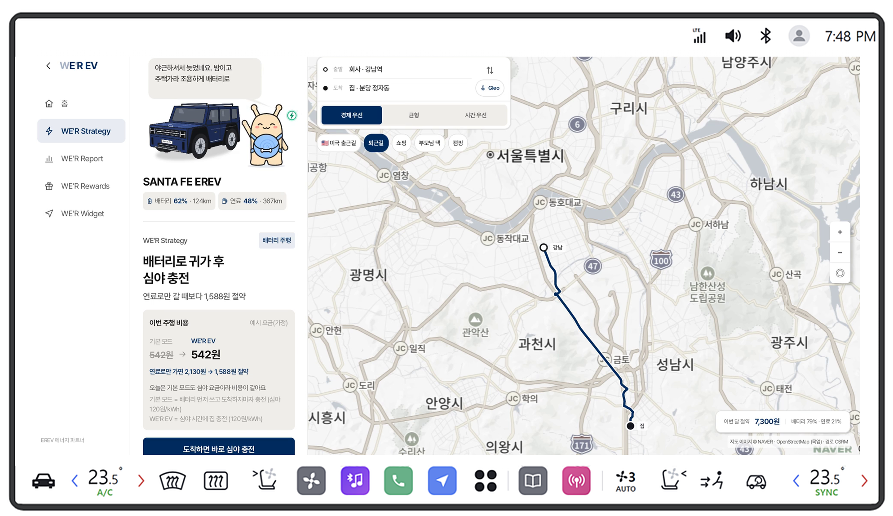<br/><b>⚡ WE'R Strategy · 퇴근길</b><br/><sub>배터리로 귀가 후 심야 충전 · 연료로만 갈 때보다 절약</sub></td>
    <td width="50%" align="center">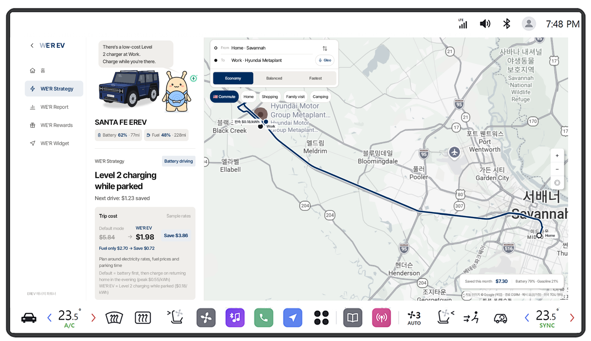<br/><b>🇺🇸 WE'R Strategy · 미국 출근길</b><br/><sub>Hyundai Metaplant Level 2 충전 · 영어 · 달러 · 마일 단위</sub></td>
  </tr>
  <tr>
    <td align="center">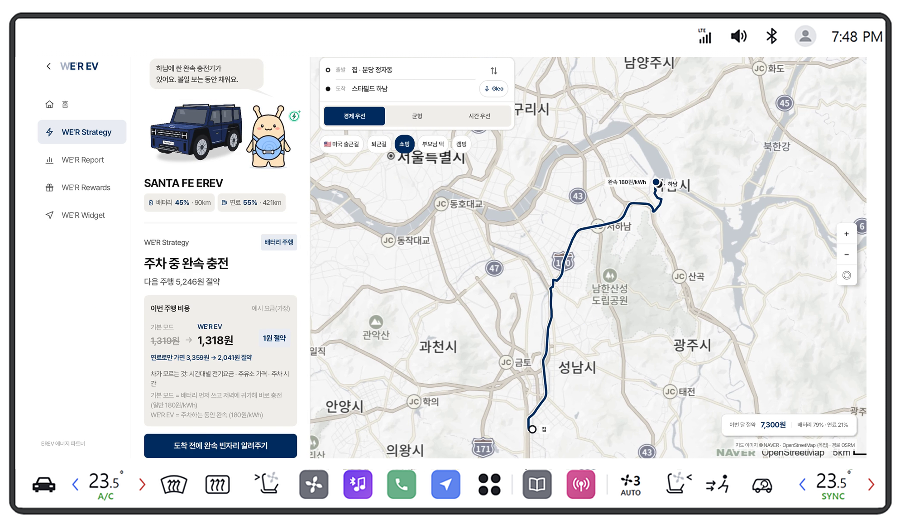<br/><b>🛍 WE'R Strategy · 쇼핑</b><br/><sub>스타필드 하남 주차하는 동안 완속 충전</sub></td>
    <td align="center">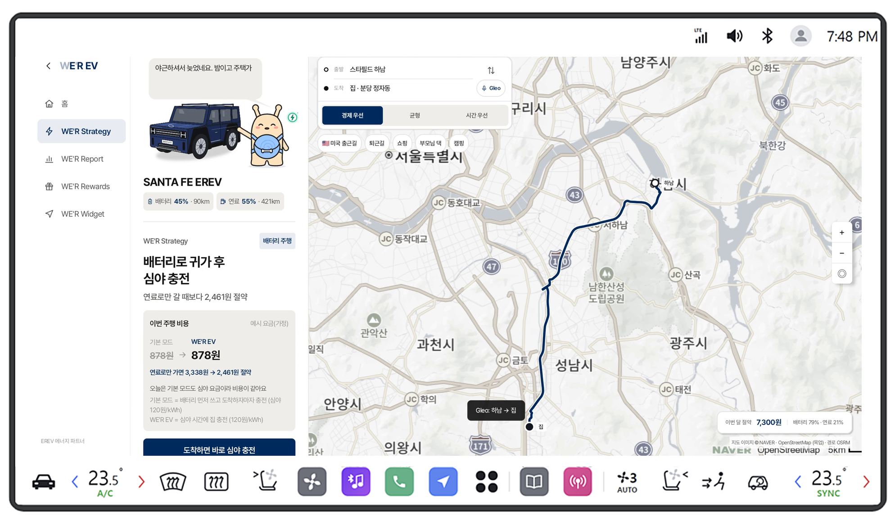<br/><b>🎙️ Gleo 음성 경로 변경</b><br/><sub>"스타필드에서 집으로 가자" → 전략 자동 재계산</sub></td>
  </tr>
  <tr>
    <td align="center">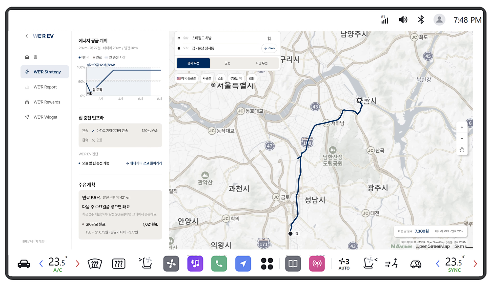<br/><b>📈 에너지 공급 계획</b><br/><sub>싼 충전 시간대 · 집 충전 인프라 · 주유 계획</sub></td>
    <td align="center">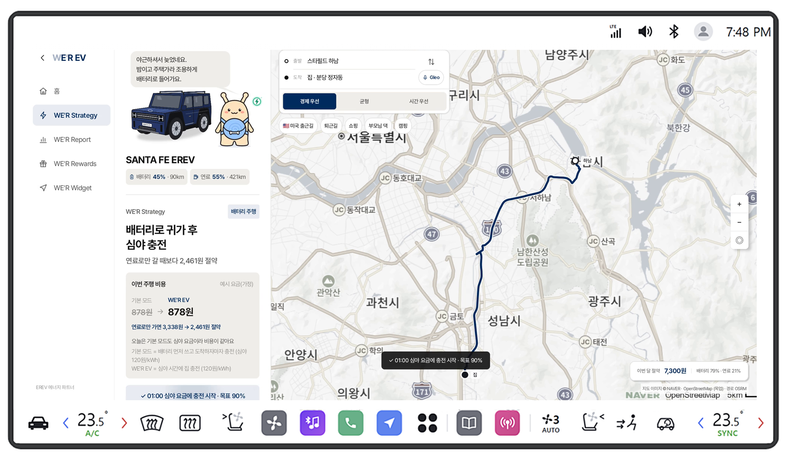<br/><b>🌙 심야 충전 예약 완료</b><br/><sub>도착하면 바로 가장 싼 시간대에 집 충전</sub></td>
  </tr>
  <tr>
    <td align="center">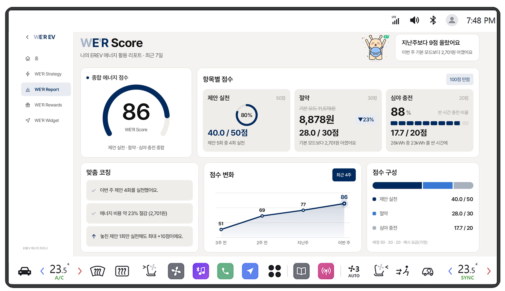<br/><b>📊 WE'R Report</b><br/><sub>제안 실천 · 절약 · 심야 충전으로 매기는 WE'R Score</sub></td>
    <td align="center">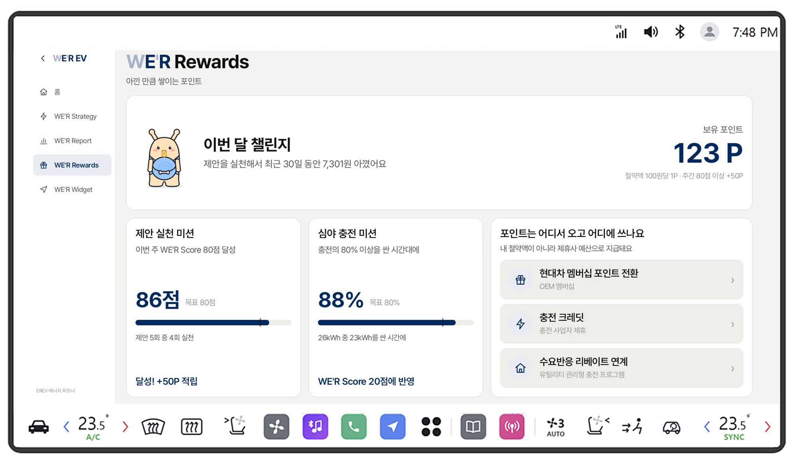<br/><b>🎁 WE'R Rewards</b><br/><sub>아낀 만큼 쌓이는 포인트와 주간 미션</sub></td>
  </tr>
  <tr>
    <td align="center">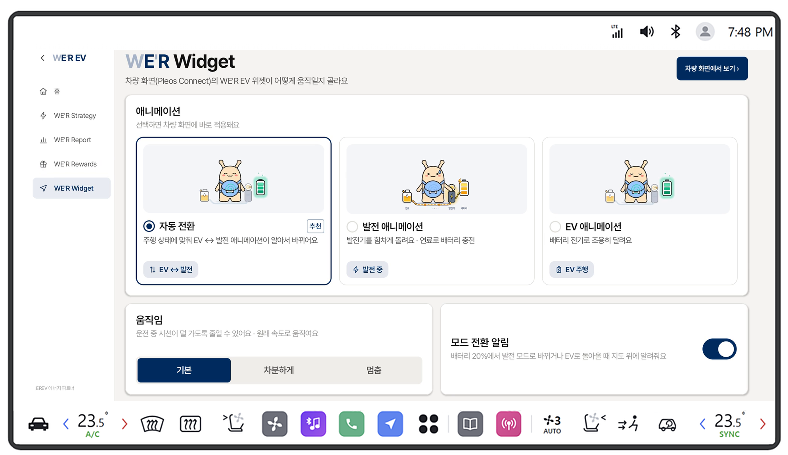<br/><b>🐌 WE'R Widget</b><br/><sub>차량 화면 위젯 애니메이션 · 움직임 · 알림 설정</sub></td>
    <td align="center">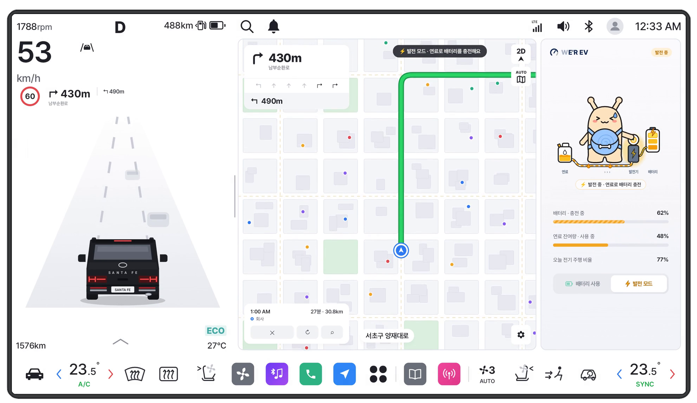<br/><b>🔥 Pleos Connect · 주행 중 발전 모드</b><br/><sub>위젯 「발전 모드」 → 연료 → 발전기 → 배터리 흐름으로 전환</sub></td>
  </tr>
</table>

<br/>

## 🧠 판단 방식

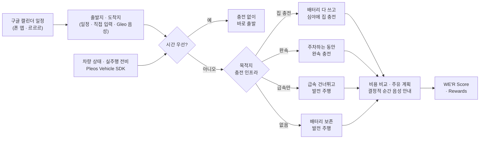

- **주행 가능 거리** — 배터리 100% = 200km, 연료 100% = 765km (홈 · 전략 · 차량 화면이 같은 계산 사용)
- **비용 비교** — 같은 거리를 *차 기본 모드*로 갔을 때 / *연료로만* 갔을 때와 비교
- **폰 1차 전략 → 차 최종 전략** — 폰은 일정 · 인프라 · 유가로 먼저 계획하고, 차는 최근 실주행 전비(히터 사용 등)를 반영해 충전 시간을 보정
- **결정적 순간 음성** — 주행당 1번만, 위젯 한 줄과 같은 문장을 TTS로 안내 (운전 중 시선 분산 최소화)
- **WE'R Score (100점)** — 제안 실천 50 · 절약 30 · 심야 충전 20

<br/>

## 📱 함께 쓰는 폰 앱

차에 타기 전, 폰 앱(`WE_R_EV_Phone`)이 **구글 캘린더 일정**을 보고 1차 충전 전략을 세워 Pleos 차량 앱으로 보냅니다. 차량 앱은 실제 주행 데이터로 그 전략을 최종 확정합니다.

### 폰 → 차로 이어지는 흐름

<div align="center">
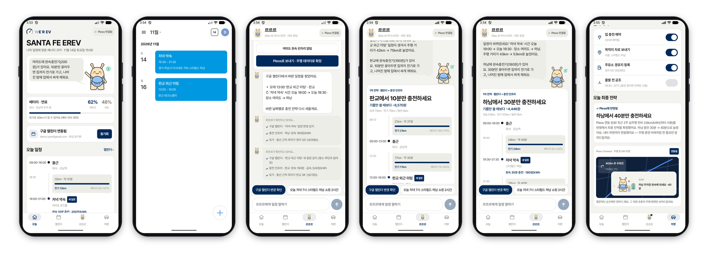
</div>

1. 📅 **구글 캘린더 연동** — 오늘 · 이번 주 일정과 동선을 불러옵니다
2. 🐌 **르르르(Gleo AI 어시스턴트)** — 일정이 바뀌면 감지하고, 목적지 충전 인프라 · 유가를 확인해 **1차 충전 전략**을 다시 세웁니다
   - 예) 판교 외근 미팅 추가 → *「판교에서 10분만 충전하세요」* / 저녁 약속 장소 여의도 → 하남 → *「하남에서 30분만 충전하세요」*
3. 🚗 **Pleos로 보내기** — 차량의 최근 2주 실주행 전비를 반영해 **최종 전략 확정** (하남 충전 30분 → 40분)
4. 🔌 **원격 제어** — 집 충전 예약 · 목적지 차로 보내기 · 주유소 경유지 등록 · 출발 전 공조
5. 🗺 **주행 중** — Pleos Connect 내비 위젯에서 결정적인 순간에만 한 줄로 안내합니다

### 폰 앱 화면

<table>
  <tr>
    <td width="33%" align="center">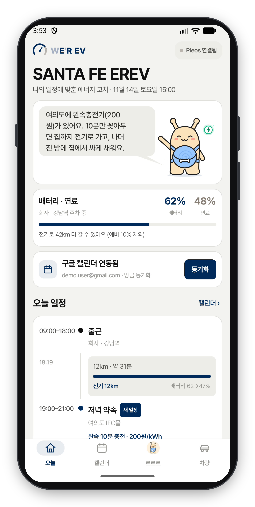<br/><b>🏠 오늘</b><br/><sub>오늘의 전략 한마디 · 배터리/연료 · 오늘 일정과 구간별 전기 주행</sub></td>
    <td width="33%" align="center">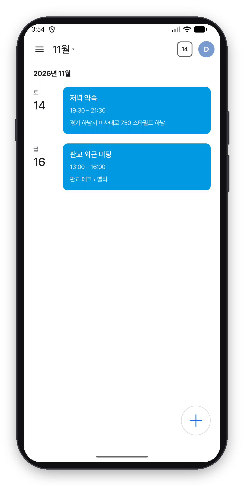<br/><b>📅 캘린더</b><br/><sub>구글 캘린더 일정 확인 · 추가 · 편집</sub></td>
    <td width="33%" align="center">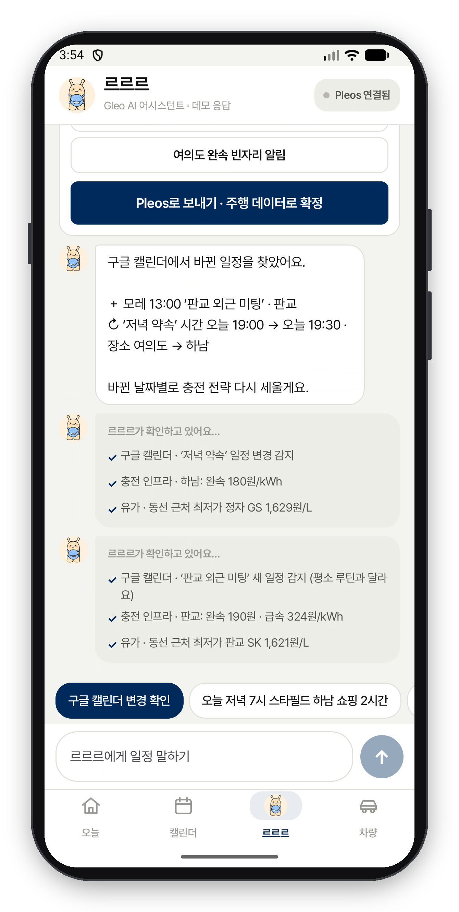<br/><b>🐌 르르르 · 일정 변경 감지</b><br/><sub>바뀐 일정 · 충전 인프라 · 동선 위 최저가 주유소 확인</sub></td>
  </tr>
  <tr>
    <td align="center">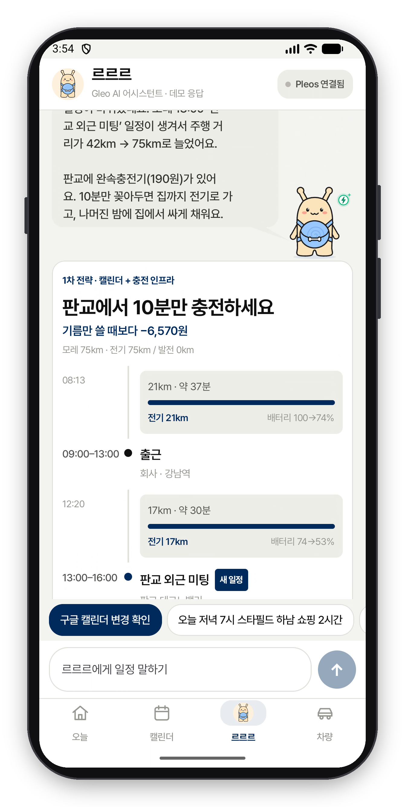<br/><b>⚡ 1차 전략 · 판교</b><br/><sub>새 외근 일정 → 판교에서 10분만 충전</sub></td>
    <td align="center">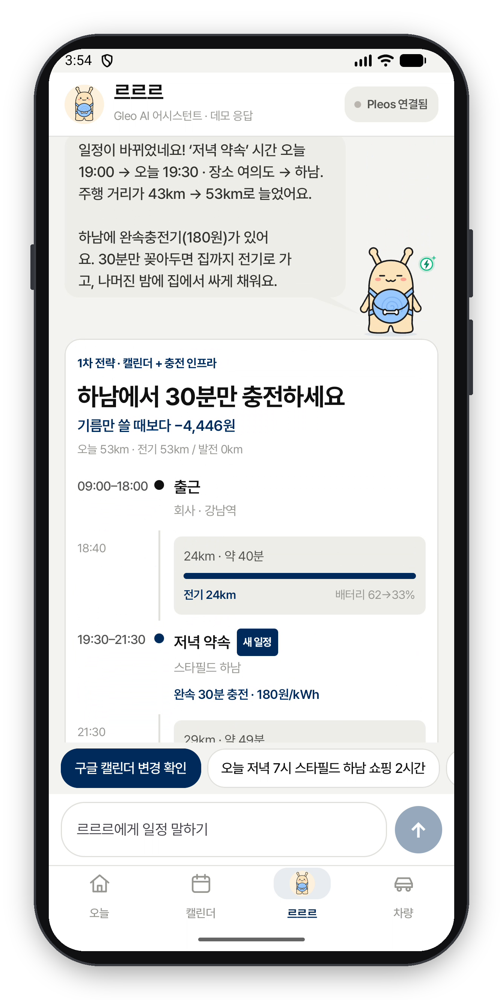<br/><b>⚡ 1차 전략 · 하남</b><br/><sub>약속 장소 변경 → 하남에서 30분 충전</sub></td>
    <td align="center">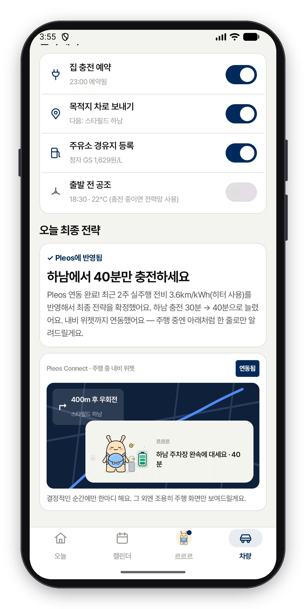<br/><b>🚗 차량 · Pleos 반영</b><br/><sub>실주행 전비로 최종 전략 확정 · 원격 제어 · 내비 위젯 연동</sub></td>
  </tr>
</table>

<br/>

## 🛠 기술 스택


<br/>

## 📁 프로젝트 구조

```
WE_R_EV/
├── WE_R_EV_Pleos/                    # 🚗 차량 앱 (Gradle 프로젝트)
│   ├── app/                          #    WE'R EV 차량 앱  ─ com.example.rrr
│   │   └── src/main/java/com/example/rrr/
│   │       ├── MainActivity.kt       #      홈 · 전략 · 사이드바 · Gleo 대화창
│   │       ├── Planner.kt            #      충전/주유 전략 · 비용 계산
│   │       ├── ScoreViews.kt         #      WE'R Report · Rewards
│   │       ├── WidgetSettingsPage.kt #      WE'R Widget 설정
│   │       ├── RrrWidgetAnimation.kt #      위젯 캐릭터 애니메이션 (Compose Canvas)
│   │       ├── GleoBridge.kt         #      Gleo 음성 명령 → 출발/도착 설정
│   │       └── pleos/                #      Pleos SDK 게이트웨이 (Vehicle · Navi · TTS)
│   ├── pleos_connect/                #    Pleos Connect 차량 화면 시뮬레이터 ─ com.example.pleosconnect
│   └── docs/                         #    워크플로우 · 검증 문서
├── WE_R_EV_Phone/                    # 📱 폰 앱 (Gradle 프로젝트) ─ com.example.rrrphone
│   └── app/src/main/java/com/example/rrrphone/
│       ├── GoogleCalendar.kt         #      구글 캘린더 연동 · 일정 변경 감지
│       ├── CalendarApp.kt            #      캘린더 화면 · CalendarEditor.kt 일정 편집
│       ├── LrrrAgent.kt              #      르르르 어시스턴트 대화 · 전략 재계산
│       ├── Planner.kt                #      일정 기반 1차 충전 전략
│       ├── NaviWidget.kt             #      Pleos Connect 내비 위젯 미리보기
│       └── Screens.kt                #      오늘 · 르르르 · 차량 화면
└── docs/
    ├── images/phone/                 #    README 스크린샷 (폰 앱)
    ├── images/pleos/                 #    README 스크린샷 (차량 앱)
    └── demo/                         #    홍보 영상 (WE_R_EV_홍보영상.mp4) · 시연 영상 (WE_R_EV_시연영상.mp4)
```

<br/>

## 🚀 실행 방법

### 준비물
- **Android Studio** (JDK는 Android Studio 내장 JBR 사용)
- **Pleos Connect v2.1.0 에뮬레이터** — 2560×1440, API 34 이상 (차량 앱)
- **Android 폰 / 에뮬레이터** — API 29 이상 (폰 앱)
- Pleos Playground SDK 는 `settings.gradle.kts` 의 Pleos Nexus 저장소에서 자동으로 받습니다

### 빌드 & 설치

```bash
# 🚗 차량 앱
cd WE_R_EV_Pleos
./gradlew :app:installDebug             # WE'R EV 차량 앱
./gradlew :pleos_connect:installDebug   # Pleos Connect 차량 화면 시뮬레이터

# 📱 폰 앱
cd ../WE_R_EV_Phone
./gradlew :app:installDebug
```

> `local.properties` 의 `sdk.dir` 이 내 PC의 Android SDK 경로와 다르면 수정하거나 `ANDROID_HOME` 환경 변수를 지정하십시오.

<br/>

## 🎮 시연 조작법

화면에는 보이지 않는 **숨은 조작**으로 주행 흐름을 재현할 수 있습니다. (시연 영상 촬영용)

| 동작 | 위치 | 결과 |
|---|---|---|
| **길게 누르기** | 전략 페이지 상단 차 · 캐릭터 그림 | 주행 시작 / 주행 종료 (점수 반영) |
| **두 번 탭** | 〃 | 결정적 순간 음성 안내 |
| **길게 누르기** | 「SANTA FE EREV」 글자 | 시연 도구 패널 열기 / 닫기 |
| **탭** | 차량 화면 위젯 하단 「배터리 사용 / 발전 모드」 | EV ↔ 발전 모드 전환 |

**Gleo 음성 명령 보내기** (실제 Gleo 가 앱에 전달하는 것과 같은 Intent)

```bash
adb shell am start -a com.example.rrr.action.SET_TRIP \
  -n com.example.rrr/.MainActivity --es utterance '스타필드에서 집으로 가자'
```

<br/>

## 📝 참고 사항

- **예시 데이터** — 배터리 62% · 연료 48%, 최근 4주 주행 기록, 전기요금 · 유가는 데모용 예시 값입니다.
- **구글 캘린더 · 르르르** — 시연용 데모 계정(`demo.user@gmail.com`) 일정과 데모 응답으로 동작합니다.
- **음성(TTS)** — Pleos TTS 를 먼저 사용하고, Pleos 서비스가 없는 기기(일반 에뮬레이터)에서는 안드로이드 기본 TTS 로 대신 읽습니다.
- **Pleos SDK 연결** — Vehicle · NaviHelper · TTS 연결에 실패하면 각 기능이 데모 값으로 동작합니다. 실시간 차량 값을 받으면 「PLEOS 실시간」 배지가 표시됩니다.
- **차량 화면 시뮬레이터** — `WereEV_PleosConnect.html` 주행 목업(1920×1080)의 레이아웃 · 아이콘을 Compose 로 옮겼습니다.

<br/>

<div align="center">

**WE'R EV** · EREV 에너지 파트너

</div>
