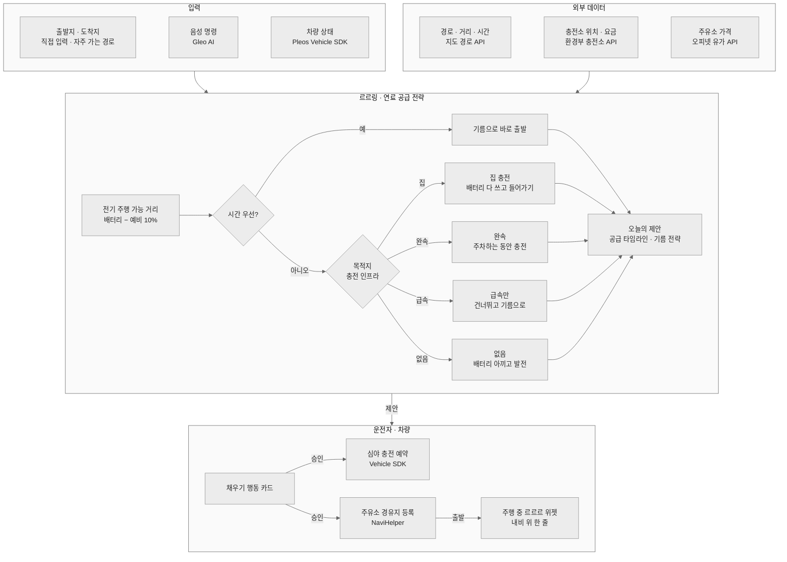

# 르르링 워크플로우 (SDK · API 연결 최종안)

## 연결 현황 (데모 → 최종)

| 구간 | 지금 (데모) | 최종 연결 |
|---|---|---|
| 차량 배터리 · 연료 | 화면의 −/+ 값, 프리셋 | Pleos Vehicle SDK |
| 음성 출발/도착 | 앱 안 Gleo 버튼 + 인텐트(`SET_TRIP`) | Gleo AI App Schema → Gleo Action |
| 경로 · 거리 · 시간 | OSRM 공개 API (실제 호출) | 상용 지도 경로 API |
| 충전소 위치 · 요금 | `Places.kt` 데모 DB | 환경부 전기차 충전소 API |
| 주유소 가격 | `Places.kt` 데모 가격 | 오피넷 유가 API |
| 심야 충전 예약 | 버튼 완료 상태만 | 차량 충전 예약 (SDK) |
| 주유소 경유지 | 지도에 표시만 | NaviHelper 경유지 등록 |
| 내비 위젯 | 정적 목업 화면 | 내비 위 오버레이 위젯 |
